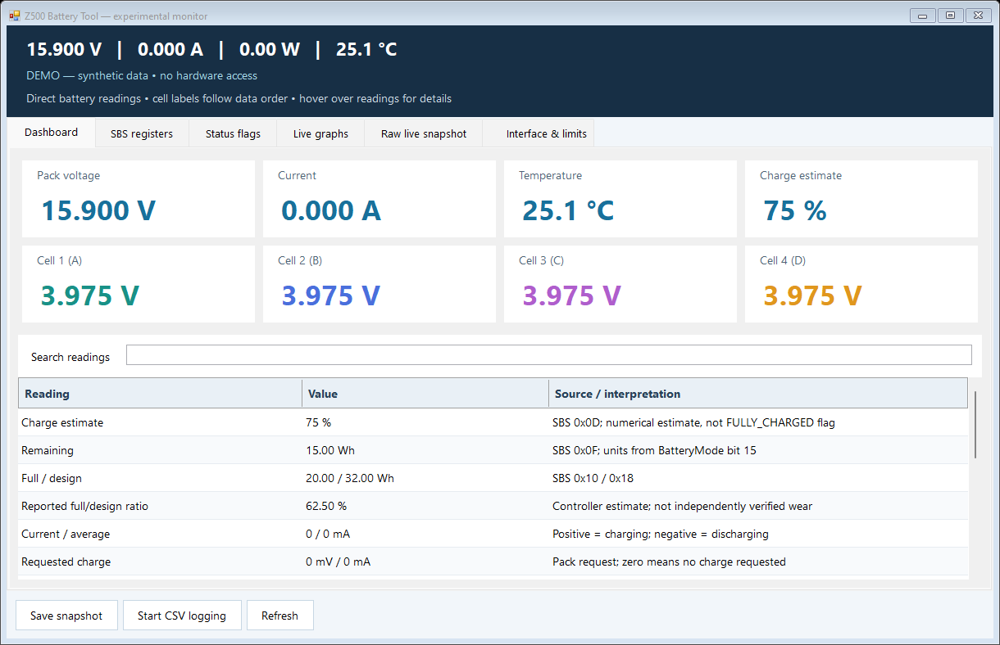
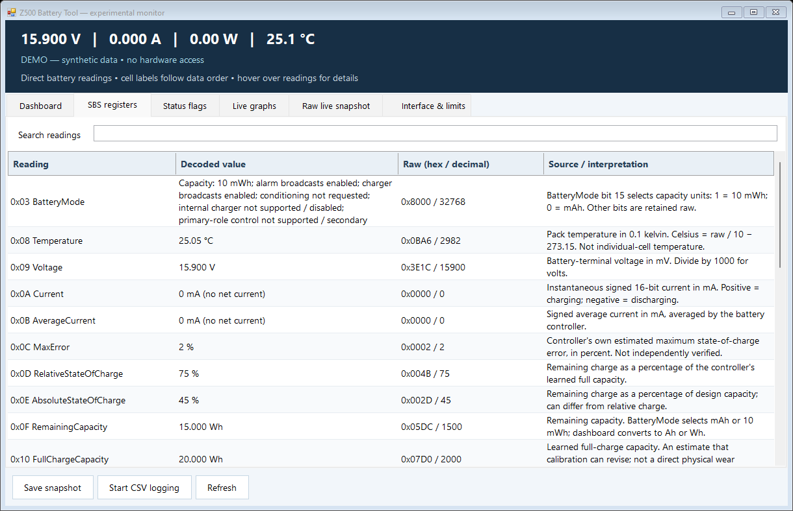
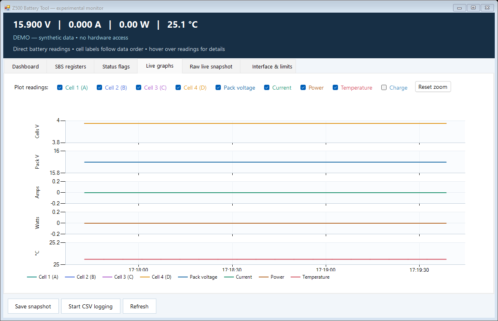

# Lenovo Z500 Battery Tool

An experimental Windows battery monitor for the Lenovo IdeaPad Z500. Reads the battery through the installed Lenovo ACPI driver and embedded-controller SMBus bridge, including pack and cell-group telemetry that ordinary Windows battery reporting does not expose.

**Only one laptop, BIOS and driver combination has been verified.** This is not a universal Z500 battery utility. Firmware and driver fingerprint checks intentionally stop access on unverified combinations. See [compatibility](docs/COMPATIBILITY.md).

## Download and run

1. Download the Windows x64 ZIP from [Releases](https://github.com/carp3/lenovo-z500-battery-tool/releases).
2. Extract it to a writable folder and run `Z500Battery.exe`.
3. Approve Windows administrator elevation. The Lenovo driver requires it for direct battery reads.

Requires 64-bit Windows, .NET Framework 4.x, and the already-installed compatible Lenovo ACPI Virtual Power Controller driver. The app does not install a driver. The executable is unsigned; no publisher certificate is provided. Do not disable Windows security protections to run it.

## Features

- Large live cards for pack voltage, signed current, temperature, charge estimate, and four cell groups.
- Selectable history graphs for individual cells, total voltage, current, power, temperature and charge, with separate scales, hover values and zoom.
- Searchable SBS registers with decoded values, raw hexadecimal/decimal values, descriptions and tooltips. Manufacture dates render as readable dates.
- Standard battery alarms, firmware-mode flags, formatted raw JSON, optional CSV logging and saved snapshots.
- Polling every six seconds and an in-memory history of 600 samples per metric. History starts when the app opens; CSV logging is optional.

### Dashboard



### Decoded registers



### Selectable graphs



Screenshots use **synthetic data**, not a real owner's battery identity or serial number. Flat lines in these examples are intentional.

## Experimental calibration: disabled by default

Official builds provide monitoring only. The calibration implementation remains in the source for custom builds, but its controls are hidden and commands are rejected while the build flag is false.

To enable it in a custom build, change the flag near the top of [`src/BuildOptions.cs`](src/BuildOptions.cs):

```csharp
internal static readonly bool EnableExperimentalCalibration = true;
```

Then compile the app yourself. **The Windows calibration start/exit commands have not been tested on hardware.** Their ACPI mapping was inspected in the matched driver and firmware; live Windows monitoring has been verified. The equivalent firmware mode was previously exercised under Linux, which does not validate this Windows implementation.

Enabled custom builds require confirmation, AC power and fresh state checks. Starting is rejected while relevant charge-stop/temperature/discharge-stop alarms are asserted. A command is followed by a GBMD mode-bit check. These checks do not establish that a learning cycle completed successfully. The application never clears battery protections, unseals the controller, forces charging, or changes critical-battery/sleep policies. Firmware calibration can continue after the app exits.

## Build and check

No .NET SDK, NuGet packages or third-party UI libraries are required. On 64-bit Windows with the .NET Framework compiler installed:

```powershell
.\build.ps1
.\build.ps1 -Test
```

The executable is written to `build/Z500Battery.exe`. Tests compile a separate non-elevating harness and use synthetic data; they do not communicate with the battery or run calibration. They cover recorded cell-layout decoding, signed current boundaries, invalid cell-sum rejection, manufacture-date decoding, unavailable time estimates, UI rendering, search persistence and graph selection.

Source is split into `Hardware`, `Telemetry`, `Formatting`, and `UI`. The small build script uses the .NET Framework compiler already bundled with Windows. Formatting follows `.clang-format` (clang-format 16 or compatible).

## Publishing

GitHub Actions builds and checks changes to `main`. The initial publication bootstraps experimental prerelease `v0.1.0`; afterward `main` updates only run checks. Push a semantic-version tag such as `v0.1.1` to build and publish another prerelease:

```sh
git tag v0.1.1
git push origin v0.1.1
```

The workflow attaches the Windows ZIP and SHA-256 checksums to the release. **Executables are release assets, never committed to the repository.** A manual workflow dispatch can also publish a specified tag. Official release jobs check that experimental calibration is disabled.

## Interpretation and privacy

All readings are the battery controller's own reports. Capacity estimates do not independently measure physical wear; identification strings and manufacture dates can be cloned. A numerical 100% charge is distinct from the FULLY_CHARGED flag. Cells 1–4 (A–D) mean manufacturer-block data order, not confirmed physical positions. Balance alone does not establish usable capacity or battery condition.

This laptop's BIOS has a known current-to-power conversion error, so terminal power is derived from direct SBS voltage and signed current. Unknown manufacturer bytes and Lenovo firmware symbols are not guessed. Failed reads clear current readings and leave a gap in graphs.

The app has no network calls. Logs and snapshots are written next to the executable and can contain pack serial/identity data. Review or redact them before sharing. Close other EC/battery probing tools to reduce contention; do not remove fingerprint checks just to make an unverified configuration run.

## References and license

- [Smart Battery Data Specification 1.1](https://sbs-forum.org/specs/sbdat110.pdf)
- [Microsoft ACPI method evaluation](https://learn.microsoft.com/en-us/windows-hardware/drivers/acpi/evaluating-acpi-control-methods)
- [Lenovo gauge-reset guidance](https://support.lenovo.com/us/en/solutions/ht069480)

[MIT license](LICENSE). Lenovo drivers and firmware are not included and are not covered by this project's license. This is an independent project, not affiliated with Lenovo.
